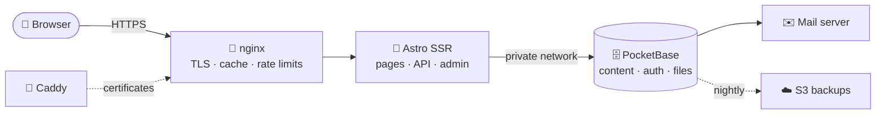

# ⚡ zouerami

**A bilingual blog and portfolio with its own back office, built to run on one small server.**
Live at **[amir-zouerami.dev](https://amir-zouerami.dev)** 🌍


---

## ✨ What it does

### 📖 For readers
- 🌐 **English and Persian**, with real right-to-left layout, Persian fonts and dates, and a per-post language switch
- 🧮 **Rich articles**: highlighted code, Mermaid diagrams, KaTeX maths, callouts, footnotes and cited references with hover cards
- 🔎 **⌘K command palette** with search, plus a table of contents and a reading progress pill
- 💬 **Comments, likes and bookmarks**, with email or GitHub / Google sign-in
- 📬 **Newsletter**, RSS in both languages, sitemap and generated social preview cards
- 🌗 Dark and light themes, custom right-click menus, and self-hosted fonts with no third-party trackers

### ✍️ For the author (`/admin`)
- 📝 **Markdown editor** with a live preview rendered by the same pipeline as the public site, synced scrolling, zen mode and image paste / drop
- 👀 **Drafts with secret preview links**, for posts and projects
- 🧱 **Layout board**: choose which posts appear on the homepage and the blog's featured collage, and where
- 🗂️ **Projects** with covers, technology chips, case studies and an optional highlight number
- 📄 CV files, comment moderation, subscribers (CSV export) and users
- 💾 Unsaved writing is backed up in the browser

---

## 🏗️ How it fits together



| Folder | What lives there |
|---|---|
| `web/` | 🚀 Astro app, React islands, the admin and all tests |
| `pocketbase/` | 🗄️ Schema and access rules (`pb_migrations/`), server hooks, email templates |
| `nginx/` | 🚦 Reverse proxy, page cache, security headers |
| `caddy/` | 🔐 Certificate issuing and renewal |
| `deploy/` | 📦 Deploy, rollback and cache purge scripts |
| `docs/` | 📚 The longer explanations |

---

## 🚀 Quick start

You need **Docker** and **[Bun](https://bun.sh)**.

```sh
cp .env.example .env          # set a superuser password and an AUTH_SECRET
docker compose -f compose.yaml -f compose.dev.yaml up -d --build
cd web && bun install && bun run seed
```

| Open | Address |
|---|---|
| 🌍 Site | <http://localhost:8088> |
| ✍️ Back office | <http://localhost:8088/admin> (`dev-admin@example.com` / `dev-admin-password-1`, created by the seed) |
| 🗄️ PocketBase dashboard | <http://127.0.0.1:8090/_/> |
| ✉️ Mailpit (all dev mail) | <http://127.0.0.1:8025> |

> 🧱 Building behind a proxy? Set `BUILD_NETWORK=host` and `BUILD_PROXY=http://127.0.0.1:PORT` in `.env`.

---

## 🛠️ Day to day

Run these in `web/`.

| Task | Command |
|---|---|
| 🔥 Dev server with hot reload | `PB_URL=http://127.0.0.1:8090 PB_PUBLIC_URL=http://127.0.0.1:8090 SITE_URL=http://localhost:4321 bun run dev` |
| 🧹 Lint and type check | `bun run check` |
| 🧪 Unit tests | `bun run test` |
| 🔌 Integration tests (PocketBase + seed) | `REQUIRE_PB=1 bun run test:integration` |
| 🎭 Browser tests (full stack on `:8088`) | `bun run test:e2e` |
| 📧 Rebuild email templates | `bun run build:emails` |
| 👑 Make someone an admin | `bun run make-admin you@example.com` |

---

## 🔒 Security in short

- 🍪 A **10-minute signed session cookie** plus PocketBase's own token, both `httpOnly`. A deleted user or changed password is locked out within 10 minutes.
- 🛂 The web app **never holds superuser credentials**. Admin requests carry the signed-in user's token, and PocketBase's rules are the real gate.
- 🚪 Only a handful of PocketBase endpoints are reachable from the internet.
- 🤖 Forms are protected by a **self-hosted proof-of-work check** and a trap field, with no third-party captcha.
- 🧯 Strict Content Security Policy, origin checks and rate limits.

## 🔍 Logs and trace ids

Every API response carries a `traceId` (also the `x-trace-id` header). Search the logs for it to see that request's whole story:

```sh
docker compose -f compose.yaml -f compose.dev.yaml logs -f web
```

---

## 📦 Deploying

Push to `main` and GitHub Actions does the rest:

1. 🧪 Run every check and test
2. 🏗️ Build the images
3. 🚇 Send them through an SSH tunnel into a **private registry on the server**
4. ❤️ Restart, check health, and **roll back automatically** if it fails

GitHub unreachable? `deploy/deploy-local.sh` does the same from your own machine (copy `deploy/local.env.example` to `deploy/local.env` first).

---

## 📚 Further reading

| | |
|---|---|
| 🏛️ [Architecture](docs/architecture.md) | Code layout, API contract, content model |
| ✍️ [Writing a post](docs/blog-post-format.md) | Everything the Markdown supports |
| 🚢 [Deployment](docs/deploy.md) | Setting up a server from scratch |
| 🔐 [Certificates](docs/cert-auto-renewal.md) | Automatic issuing and renewal |
| ✉️ [Mail server](docs/mail-server.md) | Self-hosted email |
| 🛡️ [VPN](docs/vpn.md) | Reaching private services |
| 📌 [Versions](docs/versions.md) | What is pinned and why |
