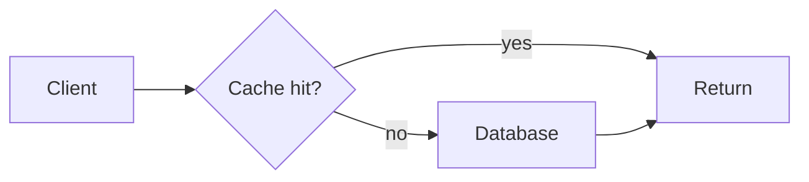
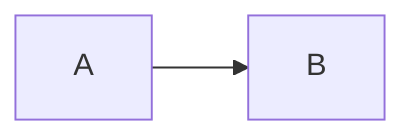

# Writing a post for amir-zouerami.dev

A bilingual (English / Persian) developer blog. Give me the post in the format below. The body is **Markdown**.
Posts are entered in the back office as separate fields, so return the metadata and the body(ies) clearly separated.

## 1. What to deliver

| Field | Rules |
|---|---|
| **Slug** | lowercase ASCII words joined by hyphens, max 120 chars: `postgres-connection-pooling` |
| **Tags** | 2–4, one or two words each, Capitalised. Existing ones: `Notes`, `Web`, `DevOps`, `Design`, `Persian`. Reuse them when they fit. |
| **Title** (per language) | required, max 300 chars, plain text |
| **Summary** (per language) | 1–2 sentences, max 1000 chars. Shown on cards, in search results and in link previews: make it concrete. |
| **Body** (per language) | Markdown, rules below |
| Date, status, featured, cover image | I set these myself |

Write **English**, **Persian**, or **both**. They are independent texts under the same slug, not word-for-word translations. A Persian post must have a Persian title.

## 2. Body structure

- **Do not write a `#` H1.** The title is the page's H1.
- Use `##` for main sections. They are **numbered automatically** (`/01`, `/02` …) and form the table of contents, so give each a short, clear name. Aim for one every ~250–400 words.
- `###` is allowed for sub-sections (not numbered, not in the contents). Do not go deeper than `###`.
- The first paragraph gets a large drop cap in English: start with a strong sentence, not a list or a heading.
- Reading time is computed automatically (about 200 words per minute). No length limit; 800–1800 words is typical.
- The **References** box (section 6) is added automatically under the text when you cite sources. Do not write a "References" section yourself.

## 3. Supported Markdown

Standard Markdown plus GitHub extras:

- paragraphs, **bold**, *italic*, ~~strikethrough~~, `inline code`
- bullet and numbered lists, task lists (`- [ ]`, `- [x]`)
- tables (GitHub pipe syntax)
- blockquotes `> …` (shown as a pull quote)
- horizontal rule `---`
- footnotes: `text[^1]` and `[^1]: the note` (for side remarks, **not** for sources: sources use section 6)
- links: `[text](https://…)` opens in a new tab; internal links are relative: `[other post](/blog/other-slug)`

**Not supported / removed:** raw HTML, `<iframe>`, embeds, video, scripts, `javascript:` links. Anything in HTML is dropped.

## 4. Code blocks

Fenced blocks with a language name. They get a terminal-style frame (language label, copy button) and GitHub light/dark highlighting.

````
```ts
const answer: number = 42;
```
````

Common languages: `ts tsx js json bash sh yaml html css sql go python dockerfile nginx diff markdown`. Other standard language names also work. Use `text` for plain output. There is no filename/title option: put the file name in the sentence before the block. Keep lines under ~90 characters (they scroll sideways on phones).

## 5. Diagrams (Mermaid)

A fenced block with the language `mermaid` is drawn as an interactive diagram (zoom, pan, full screen) in the site's colours, in both light and dark mode.

````

````

- All standard Mermaid types work: flowchart, sequence, class, state, ER, Gantt, pie, journey, mindmap, timeline, git graph.
- Keep them small (about 15 nodes at most) and use short labels. Wide diagrams become tiny on phones.
- **Do not add styling** (`style`, `classDef` colours, `%%{init}` themes): the site themes diagrams itself.
- Labels are plain text only: no HTML, no links, no click handlers (they are disabled).
- If the syntax is wrong the reader sees an error and the source, so double-check the syntax.

## 6. References (sources, benchmarks, other posts)

Cite sources with numbered markers. The reader sees a small numbered chip in the text (the cited phrase is highlighted) and a **References** box under the post with one tile per source. Numbers follow the order of first citation.

### Citing in the text

```
[the phrase being backed up][@key]      the phrase is highlighted, followed by the chip
a plain sentence that cites a source [@key].    just the chip
[my PocketBase notes][@post:pocketbase-in-production]    another post of this blog
```

- `key`: lowercase letters, digits, `-`, `_`, `.` or `:`, up to 64 characters (`tail-latency`, `bench-http-3`). Keys are case-insensitive. Reuse the same key to cite the same source again: it keeps its number.
- `[@post:slug]` links to a published post of this blog by its **slug**: the title, date and link are filled in automatically, **no definition needed**. Use it only for posts that exist.
- A key with no definition stays in the text exactly as typed (so a typo is visible). A definition that is never cited is not shown.

### Defining the source (put these lines at the end of the body)

```
[@key]: https://example.com/page "Title | by: Authors or site, 2025 | fig: 1.8× = more requests per second | note: One sentence on why it matters | type: benchmark"
```

The text in quotes is the **title first**, then optional fields separated by ` | ` (space, pipe, space), in any order:

| Field | Meaning | Limit |
|---|---|---|
| *(title)* | name of the source | 200 chars |
| `by:` | authors / site and year, shown under the tile | 140 |
| `fig:` | a **headline number**: `value = what it measures`. Shown large. Great for benchmarks: `fig: 1.8× = more requests per second`, `fig: p99 = not the mean decides how it feels`. | value 24, label 90 |
| `note:` | one or two sentences: what the source says or why you cite it. Can be Persian. | 420 |
| `type:` | optional: `benchmark`, `paper`, `code`, `docs`, `video`, `article`, `link`. **Detected automatically** from the address (GitHub → code, arXiv/ACM/DOI → paper, YouTube → video, docs/api paths → docs, "bench" in the address or title → benchmark). Only set it when the guess would be wrong. | |

Rules:
- The address must be `https://…` (or `http://…`) or a site path starting with `/`. Anything else is ignored.
- Do not use ` | ` (space-pipe-space) inside the title or a field. Do not put definitions inside code blocks.
- Titles, notes and figure labels are shown as written. In a Persian post they may be Persian; source titles are usually left in their original language.
- Use real, working addresses. Never invent a source, a number or a URL: if you do not have a link, do not cite.

### Example

```
A system with many moving parts is judged by [its slowest one percent of requests][@tail], not the average.
Fresh numbers show [a 1.8× gap between runtimes][@bench], but it shrinks once a database is involved [@bench].
I wrote down how I run it in [my production notes][@post:pocketbase-in-production].

[@tail]: https://cacm.acm.org/research/the-tail-at-scale/ "The Tail at Scale | by: Dean & Barroso, 2013 | fig: p99 = not the mean decides how it feels | note: Why rare slow requests dominate the experience when one page fans out to many services."
[@bench]: https://example.com/benchmarks/http "HTTP framework benchmark, round 3 | by: Example suite, 2026 | fig: 1.8× = more requests per second, fastest vs slowest runtime | note: Hello-world route on 4 cores with a warm cache."
```

### When to cite

- Cite claims that a reader could doubt or want to verify: benchmarks, numbers, papers, specifications, official docs, the code you refer to, talks, and **your own earlier posts**.
- 3–8 sources per post is typical. One marker per claim; repeat a key only when you come back to the same source.
- Do not cite things everybody knows, and do not cite just to look thorough. Prefer a primary source (the paper, the benchmark repository, the official docs) over a blog summarising it.

## 7. Callout boxes

Coloured boxes for tips and warnings. Kinds: `info`, `note`, `tip`, `success`, `warning`, `danger`.

```
:::tip
Short, useful advice.
:::

:::warning[Custom title]
Something that can go wrong.
:::
```

Use sparingly (0–3 per post). Without a title in brackets the box gets a default one in the post's language.

## 8. Images

Only images **I upload to the post** can be used. Reference them by file name; the text in the brackets becomes the visible caption:

```

```

- Put the image alone on its own line (that makes it a captioned figure).
- Do not use `https://…` image links: the site blocks outside images.
- If you want an image, write the reference with a descriptive file name (`img:pool-size-chart.png`) and add a list at the end of what each image should show. I will upload them.

## 9. Persian posts

- Write natural Persian, not a literal translation. The page switches to right-to-left automatically.
- Use the half-space (ZWNJ, نیم‌فاصله) in compound words (`می‌کنم`, `وب‌سایت`), Persian punctuation (`،` `؟` `«»`) and Persian digits in prose.
- Keep technical terms in English where developers do (`Docker`, `RabbitMQ`, `API`), inline in the sentence.
- Code blocks, diagrams and file names stay left-to-right and in English.
- Section numbers, callout titles and the reading time are localised by the site. The **References** box itself is always in English (its labels); only the text you write inside a source (title, `note:`, `fig:` label) follows your language.
- Citations work the same in Persian: `[عبارت مورد نظر][@key]`.

## 10. Template

````
Slug: example-post-slug
Tags: Notes, Web

--- EN ---
Title: ...
Summary: One or two concrete sentences.

Opening paragraph that hooks the reader.

## First section
Text with [a claim that needs a source][@bench]...

```bash
npm run build
```

:::tip
A useful tip.
:::

## Second section


[@bench]: https://example.com/page "Title | by: Site, 2026 | fig: 1.8× = what it measures | note: Why it matters."

--- FA ---
Title: ...
Summary: ...

متن مقاله با [ادعایی که منبع می‌خواهد][@bench]...

[@bench]: https://example.com/page "Title | note: توضیح کوتاه به فارسی"
````

## 11. Style

First person, plain and direct, technical but readable. Concrete examples and real commands over theory. Short paragraphs (2–4 sentences). No filler introductions ("In this article we will..."), no emojis in headings, no marketing tone. Say what you tried, what happened and why. Back claims with sources (section 6) instead of adjectives.
